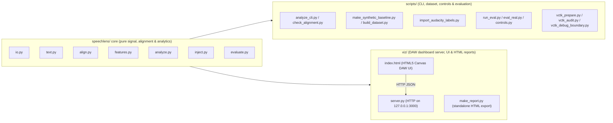

# SpeechLens Architecture

> **Track C — Contrastive Speech Analytics & Temporal Flaw Grounding**
> Multimodal AI Hackathon 2026 (IIT Mandi). Solo project. Target submission 2026-10-14.

---

## 1. Purpose

Given a participant recording and its transcript, compare against an ideal baseline reading of the same text and report:

| What | How |
|---|---|
| **Where** the delivery deviates | Word-level timestamps and merged regions |
| **What** the flaw is | `rushed`, `dragging`, `monotone`, `long_pause`, `volume_drop`, `muffled` (detector also emits `erratic_pitch`, `missing_pause`, `volume_spike`) |
| **How large** the deviation is | Observed value, reference value, threshold, magnitude (multiple of threshold) |
| **Why** it was penalised | Human-readable explanation (`explain()`) and per-region rubric penalty |

**Out of scope:** XGBoost/learned classifiers, embeddings, ASR, multilingual support, real-time streaming, user accounts, database, any "confidence %" output.

---

## 2. Design Invariants

1. **No fake confidence.** Every region carries numeric evidence. Reliability = empirical numbers from the frozen eval.
2. **Speaker-agnostic features.** Pitch: semitones relative to speaker median. Energy: dB relative to speaker median. MFCCs: cepstral mean normalisation (CMN).
3. **Single source of truth for thresholds and rubric constants.** Currently defined in `speechlens/analyze.py` (`FLOORS`, `K_MAD`, `SCORE_GAIN`, `DIMENSIONS`) and imported by evaluation scripts (`scripts/eval_real.py`, `scripts/vctk_audit.py`). (YAML config extraction remains deferred.)
4. **Synthetic and real data never mix.** Evaluated and reported separately.
5. **Threshold freeze.** Tune on speeches 1–2, `git tag thresholds-frozen`, evaluate speech 3 once.
6. **Determinism.** Injection seeded via CRC32 (`inject.seed_for()`). Dependencies pinned.
7. **Rule-based text.** Explanations are templates in `explain()`. No LLM calls.
8. **Naming honesty.** `muffled` detects high-frequency loss (> 3 kHz power share), not articulation. Label it "Muffled (high-frequency loss)".

---

## 3. Layering and Dependency Rule



**Rule:** `viz -> speechlens` and `scripts -> speechlens`. Core `speechlens/` modules import only from core siblings and never from `viz/` or `scripts/`. Standalone `viz/make_report.py` operates directly on serialized `report.json` + audio paths without importing `speechlens`.

> [!NOTE]
> `io.py` and `text.py` live in core (`speechlens/`). `align.py` imports from both. `features.py`, `analyze.py`, and `inject.py` import from core siblings only.

---

## 4. Repository Layout

```
speechlens/                          (git repo root)
├── README.md                        [EXISTS]
├── DATA_LICENSES.md                 [EXISTS] LibriVox / public-domain baseline attribution
├── plan.json                        [EXISTS] TestSprite behavioral frontend verification plan
├── requirements.txt                 [EXISTS] numpy, scipy, librosa, soundfile, praat-parselmouth, pytest
│                                             torch/torchaudio 2.5.1 commented (alignment only)
├── speechlens/
│   ├── __init__.py                  [EXISTS] defines SR = 16000
│   ├── align.py                     [EXISTS] MMS_FA forced alignment (weights_only + meta-device load)
│   ├── features.py                  [EXISTS] F0 (2-pass adaptive + Pass-2 to_pitch_cc), energy, HF share, CMN-MFCC, word_table()
│   ├── analyze.py                   [EXISTS] per-word + 3-word rolling rate, strict-seed edge expansion, rate-adjusted pause, explain(), score(), analyze()
│   ├── inject.py                    [EXISTS] 6 flaws x 4 severities, labels + re-timed alignments
│   ├── evaluate.py                  [EXISTS] iou(), match(), boundary_errors()
│   ├── io.py                        [EXISTS] load_audio() (<16 kHz warning, narrowed probe catch), save_audio()
│   └── text.py                      [EXISTS] normalize_words() (digits error, smart quotes), save/load_alignment()
├── viz/
│   ├── server.py                    [EXISTS] ThreadingHTTPServer on 127.0.0.1:3000 (25 MB cap, HTTP 400/413, tmp WAV cleanup)
│   ├── index.html                   [EXISTS] Multi-track DAW Studio UI (HTML5 Canvas + TextGrid + Inspector)
│   └── make_report.py               [EXISTS] Standalone HTML report generator with embedded base64 MP3
├── scripts/
│   ├── make_synthetic_baseline.py   [EXISTS] espeak-ng fixture builder
│   ├── build_dataset.py             [EXISTS] flawed + mixed + controls + manifest.csv
│   ├── run_eval.py                  [EXISTS] synthetic P/R/F1, boundary MAE, severity recall, --real dispatch
│   ├── eval_real.py                 [EXISTS] real-voice IoU 0.5/0.3, per-speaker tables, clean2 FP audit
│   ├── import_audacity_labels.py    [EXISTS] Audacity .labels.txt + MMS_FA -> canonical label JSON
│   ├── controls.py                  [EXISTS] 10 no-flaw negative controls (analytic + realigned)
│   ├── analyze_cli.py               [EXISTS] single-file analysis CLI
│   ├── check_alignment.py           [EXISTS] MMS_FA alignment diagnostic script
│   ├── align_to_audacity.py         [EXISTS] alignment JSON -> Audacity tab-separated labels
│   ├── dump_identity_words.py       [EXISTS] synthetic01 MMS_FA vs eSpeak identity diagnostic
│   ├── vctk_prepare.py              [EXISTS] VCTK utterances 001-005 concatenation builder
│   ├── vctk_audit.py                [EXISTS] VCTK cross-speaker control audit runner
│   └── vctk_debug_boundary.py       [EXISTS] VCTK boundary RMS energy diagnostic
├── data/
│   ├── baseline/                    [EXISTS] baseline wav files (e.g. synthetic01.wav)
│   ├── flawed/                      [EXISTS] injected flawed audio + *.align.json sidecars
│   ├── labels/                      [EXISTS] label JSONs from inject.py
│   ├── alignments/                  [EXISTS] alignment JSONs
│   ├── transcripts/                 [EXISTS] transcript .txt files (synthetic01, speech1, real_passage, vctk)
│   ├── real/                        [EXISTS] real-voice pilot takes, labels, alignments
│   ├── vctk/                        [EXISTS] VCTK cross-speaker audit clips & alignments
│   └── manifest.csv                 [EXISTS] dataset manifest
├── eval/
│   ├── synthetic_fixture_results.json  [EXISTS] initial synthetic eval output
│   ├── results.json / results_matched.json [EXISTS] matched-provenance 30-file benchmark output
│   ├── real_results.json            [EXISTS] real-voice pilot eval output
│   └── controls_matched.txt / controls_rows.csv / controls_fp.csv [EXISTS] negative controls outputs
├── results/
│   └── vctk_audit.json              [EXISTS] VCTK natural-speech cross-speaker audit output
├── samples/
│   ├── report_rushed.html           [EXISTS] standalone sample report (rushed)
│   └── report_monotone.html         [EXISTS] standalone sample report (monotone)
├── tests/
│   ├── test_pipeline.py             [EXISTS] 23 test cases (core invariants, localization, monotonicity, edge expansion, W=3 rate, HTTP 400/413)
│   ├── test_real_set_eval.py        [EXISTS] 8 test cases (Audacity import + real-set eval pipeline)
│   └── test_text_and_io.py          [EXISTS] 4 test cases (smart quotes, digit rejection, <16 kHz warning)
└── docs/
    ├── ARCHITECTURE.md              [EXISTS] this file
    ├── edge_cases.md                [EXISTS] edge-case inventory & verification status
    ├── problem_statement.md         [EXISTS] Hackathon Track C specification
    ├── DEMO_VIDEO_SCRIPT.md         [EXISTS, gitignored] video demo script
    ├── testsprite_loop_engineering.md [EXISTS, gitignored] TestSprite loop specification
    └── assets/                      [EXISTS] dashboard & demo preview captures
```

> [!NOTE]
> The earlier design brief listed optional abstractions (`configs/default.yaml`, `config.py`, `schemas.py`, `recommend.py`, `pipeline.py`, `api/` FastAPI, and `web/` React). The implemented system instead keeps `speechlens/` dependency-light, drives orchestration from `scripts/` and `viz/server.py`, and provides a zero-dependency DAW UI in `viz/index.html`.

---

## 5. Component Specifications

### 5.1 `align.py` — Forced Alignment [EXISTS]

| Item | Detail |
|---|---|
| Function | `align_words(audio_path, transcript, device="cpu")` |
| Input | Audio file path + transcript string |
| Output | `[{"word": str, "start": float, "end": float}, ...]` |
| Backend | `torchaudio.pipelines.MMS_FA` (CTC aligner), cached via `@lru_cache` in `_load_model()`. Loads bundle checkpoint with `weights_only=True` and meta-device `load_state_dict(..., assign=True)` to avoid Windows allocation failures. |
| Normalisation | Delegates to `text.normalize_words()` (lowercase, a-z + apostrophe, rejects digits) |
| Gate | Verified via `scripts/check_alignment.py` and `scripts/align_to_audacity.py` |

### 5.2 `features.py` — Feature Extraction [EXISTS]

| Item | Detail |
|---|---|
| Function | `extract(y, sr=16000) -> Features` dataclass (`sr`, `t`, `f0_st`, `energy_db`, `hf_db`, `mfcc`, `active`, `f0_median_hz`, `f0_floor_hz`, `f0_ceiling_hz`) |
| F0 | Two-pass adaptive pitch estimation (`_adaptive_pitch_bounds`: pass 1 `[50, 600]` Hz via `to_pitch_ac` -> pass 2 `[max(45.0, 0.75*q25), min(650.0, 2.5*q75)]` Hz, fallback `(75.0, 500.0)` if `< 10` voiced frames) via Parselmouth **`to_pitch_cc`** (cross-correlation, `silence_threshold=0.005`, `voicing_threshold=0.45`, `octave_cost=0.01`), semitones relative to speaker median, octave-error clamp (`_drop_octave_jumps`: `> 12` st from median or `> 6` st from 11-frame local median -> `NaN`) |
| Energy | librosa RMS -> dB relative to speaker median speech level (active frames = `> 10th-percentile + 12.0 dB`) |
| HF share | `10 * log10(power_above_3kHz / (total_power + 1e-12) + 1e-9)` in dB |
| MFCCs | 13 coefficients, cepstral mean subtracted |
| Constants | `HOP=160` (10 ms), `WIN=400` (25 ms), `NFFT=512`, `HF_CUTOFF_HZ=3000` |

**`word_table(feat, words) -> dict[str, ndarray]`:**

| Column | Description |
|---|---|
| `dur` | Word duration (seconds) |
| `gap` | Silence before the word (seconds; 0 for the first word) |
| `energy` | Mean speaker-normalised dB over the word span |
| `hf` | Mean HF-share dB over the word span |
| `pitch_range` | p90 - p10 of F0 (semitones) over a 3-word window, gating frames to `energy_db >= max - 20.0` dB (`NaN` if `< 8` voiced frames) |
| `pitch_med` | Median F0 (semitones) over a 3-word window (`NaN` if `< 8` voiced frames) |

### 5.3 `analyze.py` — Comparison Engine [EXISTS]

#### Delta Definitions

| Feature | Delta formula | Positive = | Negative = |
|---|---|---|---|
| Rate (per-word) | `ln(dur_P / dur_B)` (robust-centred) | dragging | rushed |
| Rate (`W=3` rolling) | `ln(sum(dur_P[i-1:i+2]) / sum(dur_B[i-1:i+2]))` (robust-centred, `1..N-2`) | dragging | rushed |
| Pause | `gap_P - gap_B` (robust-centred; inside `dragging`, `gap_P - gap_B * local_scale > thr_pause`) | long_pause | -- |
| Missing pause | `gap_B >= 0.35 and gap_P < 0.1` | -- | missing_pause |
| Pitch range | `ln((range_P + 0.5) / (range_B + 0.5))` (robust-centred) | erratic_pitch | monotone |
| Energy | `E_P - E_B` (robust-centred) | volume_spike | volume_drop |
| Clarity | `HF_P - HF_B` (robust-centred) | -- | muffled |

#### Thresholding

```
threshold = max(floor, K_MAD * 1.4826 * MAD)
```

| Feature | Floor | K_MAD | Edge Expansion Ratio (`_expand_runs`) |
|---|---|---|---|
| rate | 0.30 | 3.0 | 0.65 (`max(\|dcc_word\|/thr_word, \|dcc_win\|/thr_win)`) |
| pause | 0.35 | 3.0 | -- (single-boundary events) |
| pitch | 0.30 | 3.0 | 0.75 |
| energy | 5.0 dB | 3.0 | 0.65 |
| clarity | 4.0 dB | 3.0 | 0.65 |

#### Region Merging (`_runs`), Edge Expansion (`_expand_runs`) & Rate-Adjusted Pauses

- **Strict seeding (`_runs`)**: Consecutive flagged words merge into confirmed seed runs, closing gaps of `<= 1` unflagged word. Minimum seed length: `2` words (`3` for pitch and volume types). For pace (`rushed`/`dragging`), confirmed runs from per-word and centered `W=3` rolling articulation deltas are unioned before expansion.
- **Strict-seed edge expansion (`_expand_runs`)**: Only confirmed `_runs` seeds are expanded outward (left and right) across contiguous same-sign words `>= edge_ratio * thr`, then touching/overlapping intervals are merged. Weak peaks never seed new regions.
- **Rate-adjusted `long_pause` suppression**: Inside each detected `dragging` span `[s, e]` with `local_scale = max(1.0, median(dur_P / dur_B))`, candidate `long_pause` boundaries are suppressed unless `gap_P - gap_B * local_scale > thr_pause`.

#### `explain(region) -> str` [EXISTS]

Template-based causal explanation keyed on `region["type"]`. Includes observed vs reference values, delta, and threshold multiple. No LLM.

#### `score(regions, ref_duration) -> dict` [EXISTS]

| Dimension | Flaw types | Weight |
|---|---|---|
| `pace` | rushed, dragging | 0.20 |
| `pausing` | long_pause, missing_pause | 0.20 |
| `expressiveness` | monotone, erratic_pitch | 0.25 |
| `volume` | volume_drop, volume_spike | 0.15 |
| `clarity` | muffled | 0.20 |

Formulas (exactly as in code, with `ref_duration = max(ref_duration, 0.1)` and `duration_fraction = max(part_dur, base_dur) / ref_duration`):
```
dim = 100 * exp(-15 * sum(duration_fraction * (0.3 + 0.7 * severity)))
overall = 0.5 * weighted_mean + 0.5 * min(all dimensions)
```

Where `severity = clip((magnitude - 1) / 3, 0, 1)` — a **normalised 0-1 float**, not the 1-4 integer severity from `inject.py`.

#### `analyze(y_p, words_p, y_b, words_b) -> dict` [EXISTS]

Top-level entry point. Computes `T = max(words_p[-1]["end"] - words_p[0]["start"], 0.1)` and `ref_duration = max(words_b[-1]["end"] - words_b[0]["start"], 0.1)`, time-warps baseline series via `_warp()`, and returns:

```json
{
  "scores": { "pace", "pausing", "expressiveness", "volume", "clarity", "overall" },
  "regions": [ "..." ],
  "global": { "speech_duration_s", "articulation_wps", "pause_time_s", "f0_median_hz", "f0_bounds_hz" },
  "series": { "t", "participant": { "f0_st", "energy_db", "hf_db" },
                    "baseline":    { "f0_st", "energy_db", "hf_db" } },
  "words": [ { "word", "start", "end" } ]
}
```

> [!NOTE]
> No `meta` key is emitted by `analyze()`.

### 5.4 `inject.py` — Flaw Injection [EXISTS]

| Item | Detail |
|---|---|
| Flaws | `["rushed", "dragging", "monotone", "long_pause", "volume_drop", "muffled"]` |
| Severities | 1 (almost perfect) to 4 (botched); validated (`1 <= severity <= 4`) in `apply_flaw()` |
| Guards | `long_pause` requires `i >= 1`; non-pause spans require `len(seg) > 0`; `atempo` validates `0.5 <= rate <= 2.0` |
| Seeding | `seed_for(*parts)` -> CRC32 of `"\|".join(parts)` `& 0x7FFFFFFF` |
| Entry | `make_flawed(y, words, plan, sr) -> (audio, words, regions)` |
| Plan item | `{"flaw", "severity", "i", "j", "seed"}` |

**Severity parameter table (from code):**

| Flaw | Sev 1 | Sev 2 | Sev 3 | Sev 4 | Method / Unit |
|---|---|---|---|---|---|
| rushed | 1.15 | 1.35 | 1.65 | 2.0 | `ffmpeg` `atempo` speed-up factor |
| dragging | 1/1.15 | 1/1.35 | 1/1.65 | 1/2.0 | `ffmpeg` `atempo` speed-down factor |
| monotone | 0.2 | 0.45 | 0.7 | 0.9 | fraction of pitch excursion removed (`parselmouth` PitchTier) |
| long_pause | 0.4 | 0.8 | 1.4 | 2.2 | seconds of room noise inserted (`i >= 1`) |
| volume_drop | -3.0 | -6.0 | -10.0 | -16.0 | dB gain envelope with 20 ms ramps |
| muffled | 3800.0 | 3600.0 | 3350.0 | 3000.0 | 6th-order Butterworth `sosfiltfilt` low-pass cutoff Hz |

**Region dict emitted by `inject.py`:**

```json
{ "type", "severity", "start", "end", "word_start", "word_end", "base_start", "base_end" }
```

### 5.5 `evaluate.py` — Evaluation Utilities [EXISTS]

| Function | Signature | Description |
|---|---|---|
| `iou(a, b)` | Two `(start, end)` tuples -> float | Interval IoU; degenerate fallback (`abs(a[0] - b[0]) < 0.3`) if `union <= 0` |
| `match(pred, truth, iou_thr=0.3, require_type=True)` | -> `(pairs, unmatched_pred, unmatched_truth)` | Greedy one-to-one matching |
| `boundary_errors(pred, truth, pairs)` | -> `[(d_start, d_end), ...]` | Absolute boundary error per matched pair |

### 5.6 `io.py` — Audio I/O [EXISTS]

| Function | Description |
|---|---|
| `load_audio(path, sr=16000)` | Probes `sf.info(str(path))` (catching `(OSError, RuntimeError)`) and emits `UserWarning` if native sample rate `< sr`, then loads via `librosa.load(..., sr=sr, mono=True)` as `float32` |
| `save_audio(path, y, sr=16000)` | `soundfile.write`, clips to `[-1.0, 1.0]`, `PCM_16` |

### 5.7 `text.py` — Text Utilities [EXISTS]

| Function | Description |
|---|---|
| `normalize_words(text)` | Rejects numeric digits (`ValueError`), normalises smart quotes/backticks (`\u2018`, `\u2019`, `` ` `` -> `'`), extracts `[a-z']+` tokens, strips boundary apostrophes |
| `save_alignment(path, words)` | Write `{"words": [{word, start, end}]}` JSON |
| `load_alignment(path)` | Read and return `words` list |

### 5.8 `viz/` — Interactive DAW Studio & Standalone Reports [EXISTS]

| File | Responsibility |
|---|---|
| `viz/server.py` | Zero-dependency `ThreadingHTTPServer` listening on `127.0.0.1:3000` (localhost only, no wildcard CORS). Serves `GET /` (`index.html`), `GET /api/presets` (5 curated presets), `GET /audio/<id>` (preset or `tmp_*.wav` files checked via `.resolve().is_relative_to()`), `GET /samples/<file>` (guarded via `.resolve().is_relative_to()`), `GET /health`, and `POST /api/analyze` (enforces `MAX_UPLOAD_BYTES = 25 MB` with HTTP `413`, returns HTTP `400` on `ValueError` such as digits/empty transcript or word-count mismatch, prunes `tmp_*_*.wav` older than 30 min via `_cleanup_old_tmp_wavs()`, and runs `analyze()` using cached preset alignments or uploaded WAVs aligned via `align_words`). |
| `viz/index.html` | Multi-track HTML5 Canvas DAW studio (`SpeechLens Studio`): `#presetSelect` (`Evaluation Take:`), `#btnToggleDrawer` (`Upload Takes`), `#btnRunAnalysis` (`Analyze Speech Take`), dual track lanes (`#canvasCh1`, `#canvasCh2`) with trace tabs (`f0_st`, `energy_db`, `hf_db`), sweeping playhead (`#globalPlayhead`), time ruler (`#canvasRuler`), TextGrid word strip (`#dialogueWords`), minimap (`#canvasMinimap`), rubric ring (`#masterScoreVal`, `#scoreBadge`) + 5 VU meters (`#valPace`, `#valPausing`, `#valPitch`, `#valVolume`, `#valClarity`), flaw navigator (`#flawsListContainer`) & inspector (`#flawDetailView`, `#btnAuditionPart`, `#btnAuditionRef`), and bottom transport dock (`#lcdTimecode`, `CH-1 Part`/`CH-2 Ref` solo toggle, Spacebar play/pause, speed selector). Uses `textContent` for error banners. |
| `viz/make_report.py` | CLI generating standalone HTML reports (`--participant`, `--baseline`, `--out`) by transcoding audio to MP3 via `ffmpeg` (inside `try/finally` temp cleanup), base64-embedding `<audio>` payloads, escaping `</` as `<\/` in inline JSON, and inserting region text/explanations via `textContent`. |

### 5.9 `scripts/` — CLI, Dataset, Controls & Evaluation Runners [EXISTS]

| Script | Responsibility |
|---|---|
| `scripts/controls.py` | Runs 10 negative controls (`identity`, `tempo_0.9`, `tempo_1.1`, `pitch_-3`, `pitch_+3`, `mp3_64k`, `noise_20dB`, `noise_10dB`, `gain_-6`, `gain_+6`) across both analytic alignments and `MMS_FA` realignments; outputs `controls_rows.csv`, `controls_fp.csv`, and `controls_matched.txt`. |
| `scripts/import_audacity_labels.py` | Discovers audio and `.labels.txt` files under `data/real`, ensures `MMS_FA` alignments, and converts Audacity labels (`long_pause`, `missing_pause` multi-boundary spans, and acoustic word-span flaws) into canonical label JSONs with `raw_start`/`raw_end`. |
| `scripts/eval_real.py` | Real-voice evaluation runner (also dispatched by `run_eval.py --real`) computing per-flaw and per-speaker P/R/F1 at IoU `>= 0.5` and `>= 0.3` (raw Audacity seconds primary, word-snapped IoU secondary), boundary MAE, and `clean2` false-positive audits (`eval/real_results.json`). |
| `scripts/run_eval.py` | Synthetic benchmark runner evaluating single/mixed/control takes (with optional `--realign`, `--realign-baseline`, `--refresh-realignments`), reporting IoU `0.3`/`0.5` metrics, severity recall (`>= 0.5`), `<= 40 ms` word statistics, and Spearman rank correlations. |
| `scripts/check_alignment.py` & `scripts/align_to_audacity.py` | Forced alignment spot-check diagnostics and Audacity tab-separated label export. |
| `scripts/vctk_prepare.py`, `scripts/vctk_audit.py`, `scripts/vctk_debug_boundary.py` | Cross-speaker natural-speech control audit tooling on CSTR VCTK (v0.92). |

*Deferred / not implemented from early brief:* `configs/default.yaml`, `config.py`, `schemas.py`, `recommend.py`, `pipeline.py`, FastAPI `api/`, and React `web/`.

---

## 6. Data Contracts

### 6.1 `analyze()` Output — Region Object (as in code)

| Key | Type | Description |
|---|---|---|
| `type` | string | Flaw identifier: `rushed`, `dragging`, `monotone`, `erratic_pitch`, `long_pause`, `missing_pause`, `volume_drop`, `volume_spike`, `muffled` |
| `word_start` | int | Start word index (0-based) |
| `word_end` | int | End word index (0-based, inclusive) |
| `start` | float | Region start time on participant timeline (seconds) |
| `end` | float | Region end time on participant timeline (seconds) |
| `base_start` | float | Region start time on baseline timeline (seconds) |
| `base_end` | float | Region end time on baseline timeline (seconds) |
| `text` | string | Transcript words in the region |
| `metric` | string | Human-readable metric name (e.g. `"median word duration"`) |
| `unit` | string | Unit of observed/reference (e.g. `"s/word"`, `"dB"`, `"semitones"`) |
| `observed` | float | Participant's measured value |
| `reference` | float | Baseline's measured value |
| `delta` | float | Mean centred delta over the region |
| `threshold` | float | Detection threshold used |
| `magnitude` | float | `mean(abs(centred_delta[i:j+1])) / threshold` — multiple of the threshold |
| `severity` | float | `clip((magnitude - 1) / 3, 0, 1)` — normalised 0-1 |
| `explanation` | string | Output of `explain()` |

**Planned additions:** `recommendation` (string), `word_indices` (list).

### 6.2 `analyze()` Output — Series Object (as in code)

| Key | Sub-keys | Description |
|---|---|---|
| `t` | -- | Frame times (seconds), downsampled by step=2 |
| `participant` | `f0_st`, `energy_db`, `hf_db` | Participant frame-level features (NaN -> `null`) |
| `baseline` | `f0_st`, `energy_db`, `hf_db` | Baseline features time-warped to participant timeline via word anchors |

### 6.3 `analyze()` Output — Global Object (as in code)

| Key | Type |
|---|---|
| `speech_duration_s` | float |
| `articulation_wps` | `{ participant: float, baseline: float }` |
| `pause_time_s` | `{ participant: float, baseline: float }` |
| `f0_median_hz` | `{ participant: float, baseline: float }` |
| `f0_bounds_hz` | `{ participant: [float, float], baseline: [float, float] }` |

### 6.4 Alignment JSON (from `text.py`)

```json
{ "words": [{ "word": "we", "start": 0.5, "end": 0.72 }] }
```

### 6.5 Label JSON (from `build_dataset.py` / `inject.py`)

```json
{
  "id": "synthetic01__rushed_s4",
  "baseline": "synthetic01",
  "kind": "single",
  "regions": [{
    "type": "rushed", "severity": 4,
    "start": 2.31, "end": 5.67,
    "word_start": 8, "word_end": 17,
    "base_start": 2.31, "base_end": 6.12
  }],
  "words": [{ "word": "we", "start": 0.5, "end": 0.72 }]
}
```

### 6.6 Manifest (from `build_dataset.py`)

**Format:** CSV (`manifest.csv`), not JSON.

| Column | Description |
|---|---|
| `file` | File id (stem) |
| `baseline` | Baseline id |
| `kind` | `single`, `mixed`, or `control` |
| `flaws` | Flaw type(s), `+`-separated for mixed |
| `severity` | Integer 1-4 or empty |

### 6.7 Eval Results JSON (from `run_eval.py`)

Output path: `eval/results.json`. Keys:

```json
{
  "per_type":     { "<flaw>": { "recall", "precision", "f1", "tp", "fn", "fp" } },
  "per_severity": { "1": 0.17, "2": 0.71, "3": 1.0, "4": 1.0 },
  "boundary_mae_s": { "start": 0.103, "end": 0.037, "mean_iou": 0.951 },
  "controls":     { "files": 2, "false_regions": 0 },
  "score_vs_severity_spearman": { "<flaw>": -1.0 }
}
```

---

## 7. Data and Evaluation Architecture

### 7.1 Splits

| Split | Content | Use |
|---|---|---|
| `tune` | Speeches 1-2 (real baselines + injected flaws) | Threshold tuning only |
| `test` | Speech 3, different speaker if possible | **Locked**, evaluated once after `thresholds-frozen` tag |
| `real_flawed` | Own recordings, labelled in Audacity | Independent evaluation, reported separately |
| `synthetic` | espeak-ng voice, 28 files | Development only — optimistic and circular |

> [!NOTE]
> Synthetic splits live under `data/{baseline,flawed,labels,alignments}/` (tracked via `manifest.csv`), while real-voice recordings and VCTK controls live under `data/real/` and `data/vctk/`.

### 7.2 Negative Controls [EXISTS]

`scripts/controls.py` generates and evaluates 10 no-flaw controls per baseline across both analytic and `MMS_FA`-realigned paths:
- Identity copy, global gain (`-6 dB`, `+6 dB`), pitch shift (`-3 st`, `+3 st`), tempo shift (`0.9x`, `1.1x`), MP3 `64k` re-encode (via `ffmpeg`), and additive white noise (`20 dB`, `10 dB` SNR).

`build_dataset.py` also generates 2 negative controls per baseline (`control_gain` x0.5, `control_noise` sigma=0.003).

**Different-speaker comparison** is evaluated separately via `scripts/vctk_audit.py` on CSTR VCTK (v0.92).

### 7.3 Metrics (`run_eval.py` & `eval_real.py`) [EXISTS]

Implemented:
- Per-type precision / recall / F1 at IoU `>= 0.3` and `>= 0.5`
- Per-speaker precision / recall / F1 (`eval_real.py`)
- Recall by severity (at strict IoU `>= 0.5`)
- Boundary MAE (start / end) and mean IoU (raw Audacity & snapped in `eval_real.py`)
- Control false positives (`controls` in `run_eval.py`, `clean2_false_positives` in `eval_real.py`)
- Flagged words `<= 40 ms` diagnostics (`run_eval.py`)
- Spearman(severity, overall score)

### 7.4 Benchmark Results

**Matched-provenance synthetic benchmark (`eval/results_matched.json`, 30 files, `MMS_FA` on both sides):**

| Metric | Value |
|---|---|
| IoU `>= 0.5` Recall / Precision / F1 | 0.83 (30/36) / 1.00 (30/30) / 0.91 |
| IoU `>= 0.3` Recall / Precision / F1 | 0.83 (30/36) / 1.00 (30/30) / 0.91 |
| Recall by severity 1–4 (IoU `>= 0.5`) | 0.33, 0.80, 1.00, 1.00 |
| Boundary MAE start / end / mean IoU | 0.049 s / 0.140 s / 0.938 |
| Control false regions (`results_matched.json` / `controls_matched.txt`) | 0 / 2 files (`0 / 18` active control runs) |
| Spearman(severity, overall score) | -0.95 (`monotone`), -1.00 (`rushed`, `dragging`, `long_pause`, `volume_drop`, `muffled`) |

*(Historical initial eSpeak fixture output is preserved in `eval/synthetic_fixture_results.json`.)*

---

## 8. Local Web Server (`viz/server.py`) [EXISTS]

Zero-dependency `http.server.ThreadingHTTPServer` bound to `127.0.0.1:3000` (localhost only; no wildcard CORS headers).

| Method + Path | Purpose |
|---|---|
| `GET /`, `GET /index.html` | Serves the DAW dashboard (`viz/index.html`) |
| `GET /api/presets` | Returns the 5 presets (`real01_rushed`, `synthetic01_rushed`, `synthetic01_monotone`, `synthetic01_dragging`, `real01_clean`) with transcript text and audio availability |
| `GET /audio/{id}` | Streams preset (`<id>__part` / `<id>__base`) or uploaded temporary WAV (`tmp_*` path-validated via `.resolve().is_relative_to()`) |
| `GET /samples/{file}` | Serves standalone sample HTML files (path-validated via `.resolve().is_relative_to()`) |
| `GET /health` | Returns `{"status": "ok", "app": "SpeechLens", "version": "1.0.0"}` |
| `POST /api/analyze` | Accepts JSON (`preset_id` or base64 `participant_b64` + `baseline_b64` + `transcript`), enforces `25 MB` `Content-Length` cap (HTTP `413`), prunes `tmp_*_*.wav` > 30 min, returns HTTP `400` on `ValueError` (digits, empty transcript, word-count mismatch), runs `align_words` + `analyze()`, and returns analysis JSON + audio URLs |

---

## 9. Interactive DAW Studio & Standalone Reports (`viz/index.html`, `viz/make_report.py`) [EXISTS]

Zero-build HTML5 Canvas DAW interface (`viz/index.html`, `SpeechLens Studio`) paired with `viz/make_report.py`:

1. **Header & Ingestion Drawer** — `#presetSelect` preset picker (`Evaluation Take:`), collapsible `#btnToggleDrawer` (`Upload Takes`) for custom audio + transcript with live word counter, and `#btnRunAnalysis` (`Analyze Speech Take`).
2. **Multi-Track DAW Timeline** — Dual stacked Canvas lanes (`#canvasCh1` participant, `#canvasCh2` baseline) with trace tabs (`Pitch Contour (F0)`, `Loudness (dB)`, `Spectral Clarity (>3kHz)`), flaw region highlight boxes, sweeping playhead (`#globalPlayhead`), timecode ruler (`#canvasRuler`), and waveform minimap (`#canvasMinimap`).
3. **Time-Aligned Dialogue Tier** — `#dialogueWords` word chips with click-to-seek and flawed-word highlighting.
4. **Studio Inspector** — Master score ring (`#masterScoreVal`, `#scoreBadge`), 5 calibrated VU meters (`#valPace`, `#valPausing`, `#valPitch`, `#valVolume`, `#valClarity`), Flaw Navigator (`#flawsListContainer`), and Flaw Detail View (`#flawDetailView`) with observed/reference/delta/tolerance metrics, grounded explanation, and A/B snippet audition (`#btnAuditionPart`, `#btnAuditionRef`).
5. **Master Transport Bar** — Fixed bottom bar with `#lcdTimecode`, `CH-1 Part` / `CH-2 Ref` solo toggle, prev/next flaw step, ±5s skip, Play/Pause (`Space`), and speed selector (`0.75x`, `1.0x`, `1.25x`).
6. **Standalone HTML Reports (`viz/make_report.py`)** — Generates self-contained HTML reports with `ffmpeg`-transcoded base64 MP3 audio, `</` JSON escaping, and `textContent` DOM insertion.

---

## 10. Testing and Reproducibility

### 10.1 Existing Tests [EXISTS — 35 test cases across 3 files]

| File | Cases | Coverage |
|---|---|---|
| `tests/test_pipeline.py` | 23 | Identical/gain controls, pitch bounds & `to_pitch_cc` parity, duration injection direction, localization across all 6 `FLAWS` (IoU `>= 0.3`), injection determinism (MD5), mismatched transcript rejection, severity monotonicity across all 6 `FLAWS`, `_expand_runs` strict-seed growth, `dragging` stretched-pause suppression, `W=3` windowed speaking-rate detection, and `viz/server.py` HTTP `400`/`413` validation (skipped if `espeak-ng` absent) |
| `tests/test_real_set_eval.py` | 8 | Speaker ID extraction, take-type helpers, Audacity `.labels.txt` parsing (including `\` lines), segment/`long_pause`/`missing_pause`/`clean2` conversion, and end-to-end `run_real_eval` pipeline |
| `tests/test_text_and_io.py` | 4 | Smart-quote normalization, numeric digit rejection (`ValueError`), `< 16 kHz` `UserWarning`, clean 16 kHz loading |

### 10.2 One-Shot Reproduce (PowerShell)

```powershell
py -3.12 -m venv .venv
.\.venv\Scripts\Activate.ps1
pip install -r requirements.txt
pip install torch==2.5.1 torchaudio==2.5.1 --index-url https://download.pytorch.org/whl/cpu
pytest -v
# Dataset build & matched-provenance eval:
python scripts/make_synthetic_baseline.py --out data
python scripts/build_dataset.py
python scripts/run_eval.py --realign --realign-baseline --refresh-realignments --out eval\results_matched.json
# Single analysis / DAW studio:
python scripts/analyze_cli.py --participant p.wav --baseline data\baseline\<id>.wav --transcript data\transcripts\<id>.txt
python viz/server.py
```

---

## 11. Scoring Map (Track C Weights)

| Criterion | Weight | Components | Evidence |
|---|---|---|---|
| Data engineering and stress testing | 30% | `inject.py`, `scripts/controls.py`, `scripts/build_dataset.py`, `scripts/import_audacity_labels.py`, `scripts/vctk_*.py` | `manifest.csv`, controls tables, severity-gradient recall, VCTK audit |
| Causal explainability and temporal grounding | 25% | `align.py`, `analyze.py` regions, `explain()`, `scripts/eval_real.py` | boundary MAE/IoU, inspector evidence, per-region penalties |
| Feature extraction | 20% | `features.py` | FFT/MFCC/2-pass F0/rate/pauses/clarity |
| Dashboard | 15% | `viz/server.py`, `viz/index.html`, `viz/make_report.py` | multi-track DAW timeline overlay, upload/preset flow, standalone HTML export |
| Reproducibility and code quality | 10% | `requirements.txt`, `tests/*` (35 tests), `README.md`, `DATA_LICENSES.md` | one-shot reproduce, `pytest -v` |

---

## 12. Build Status

| Phase | Task | Status |
|---|---|---|
| 1 | Alignment gate on real speech (`scripts/check_alignment.py`, `speech1.wav`) | DONE |
| 2 | Core edge-case hardening (`text.py`, `io.py`, `analyze.py`, `inject.py`) + unit tests | DONE |
| 3 | Negative controls (`scripts/controls.py`), Audacity label import (`scripts/import_audacity_labels.py`), real-eval runner (`scripts/eval_real.py`), matched benchmark (`eval/results_matched.json`) | DONE |
| 4 | VCTK natural-speech cross-speaker control audit (`scripts/vctk_*.py`, `results/vctk_audit.json`) | DONE |
| 5 | Interactive DAW studio dashboard (`viz/server.py`, `viz/index.html`) + standalone HTML reports (`viz/make_report.py`) | DONE |
| 6 | Full real-speaker flawed-set collection & final benchmark tag (`real-set-eval`) | IN PROGRESS (pilot ingested) |

---

## 13. Known Limitations

Carry into the technical document verbatim:

1. Synthetic results are optimistic and circular: the injector and detector share signal assumptions.
2. Thresholds were originally tuned on one synthetic voice; real-speech tuning uses only 2 speeches with 1 held out.
3. Speaker independence is demonstrated narrowly (few speakers); residual cross-speaker variation is reported, not eliminated.
4. `muffled` detects high-frequency loss, not true mumbling or articulation errors.
5. Forced alignment quality bounds all temporal grounding; MMS_FA was verified only on the spot-checked clips.

---

## 14. Brief vs Implemented Code Resolutions

| # | Original Brief / Early Draft | Current Implementation | Resolution |
|---|---|---|---|
| 1 | `check_alignment.py` | Implemented in `scripts/check_alignment.py` | Documented as `[EXISTS]` |
| 2 | Audio I/O module `audio_io.py` | Implemented as `speechlens/io.py` (`load_audio()`, `save_audio()`) | `io.py` canonical |
| 3 | `text.py`, `evaluate.py` omitted | Implemented in `speechlens/text.py` and `speechlens/evaluate.py` | Documented as `[EXISTS]` |
| 4 | Data layout: `data/synthetic/`, `data/real/`, `data/transcripts/` | Synthetic in `data/{baseline,flawed,labels,alignments}/`; real takes in `data/real/`; VCTK in `data/vctk/`; transcripts in `data/transcripts/` | Documented actual layout |
| 5 | Brief mentions 6 flaw types | Detector emits 9 types: `rushed`, `dragging`, `monotone`, `erratic_pitch`, `long_pause`, `missing_pause`, `volume_drop`, `volume_spike`, `muffled` | All 9 documented |
| 6 | Region key `word_indices` | Code uses `word_start` + `word_end` (int) plus `base_start`/`base_end` | Code wins |
| 7 | `severity` scale ambiguity | `analyze.py` region `severity` = `clip((mag-1)/3, 0, 1)` (float 0–1); `inject.py` `severity` = integer 1–4 | Documented both |
| 8 | Manifest `manifest.json` / frozen eval path | Code writes `data/manifest.csv` and `eval/results_matched.json` / `eval/real_results.json` | Code wins |
| 9 | FastAPI + React/Vite dashboard | Implemented via zero-dependency `viz/server.py` + `viz/index.html` DAW studio + `viz/make_report.py` | Code wins |
| 10 | `muffled` cutoffs early draft | Code uses `[3800.0, 3600.0, 3350.0, 3000.0]` Hz | Code wins |

---

## Future Work

Items explicitly out of scope for the hackathon:

- XGBoost or learned classifiers
- Embedding-based similarity
- Automatic speech recognition (ASR)
- Multilingual support
- Real-time streaming analysis
- User accounts and authentication
- Persistent database backend
- Any "confidence %" output
